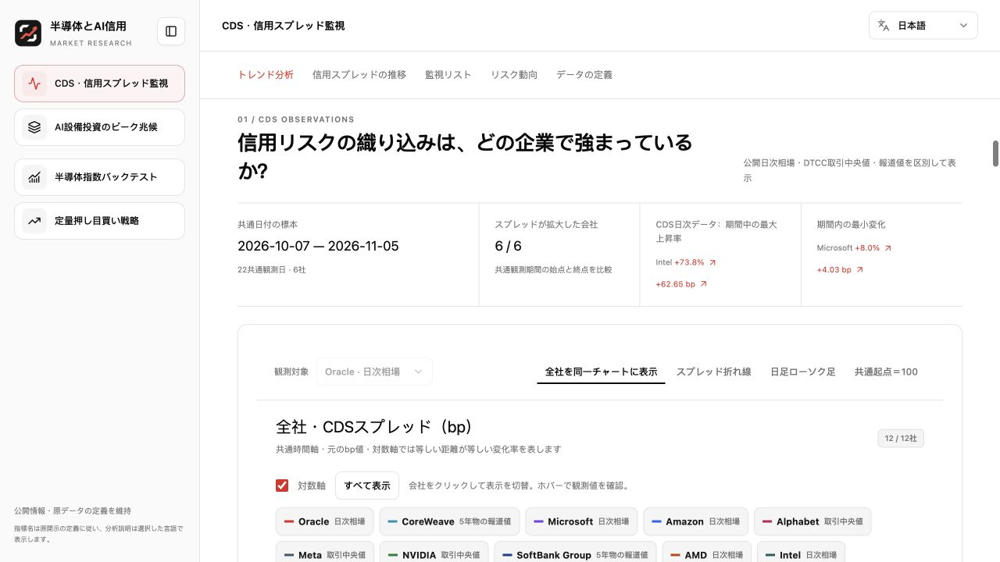
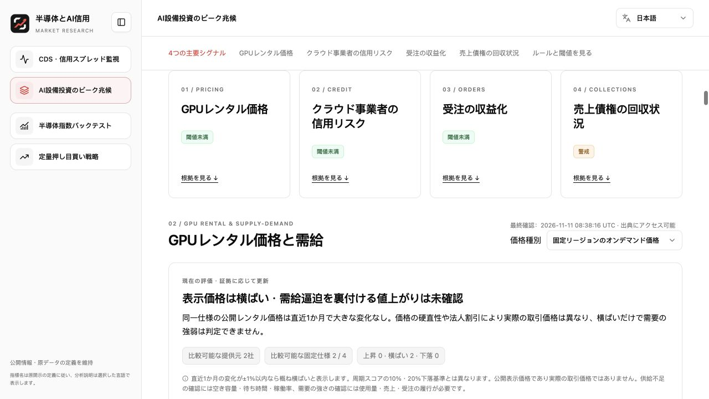
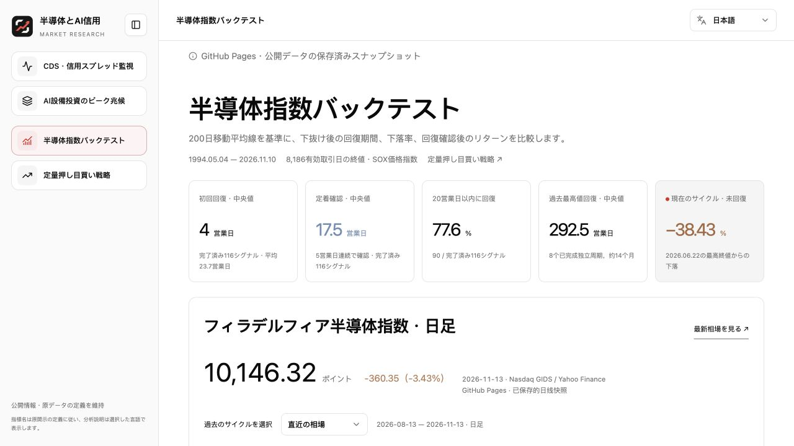
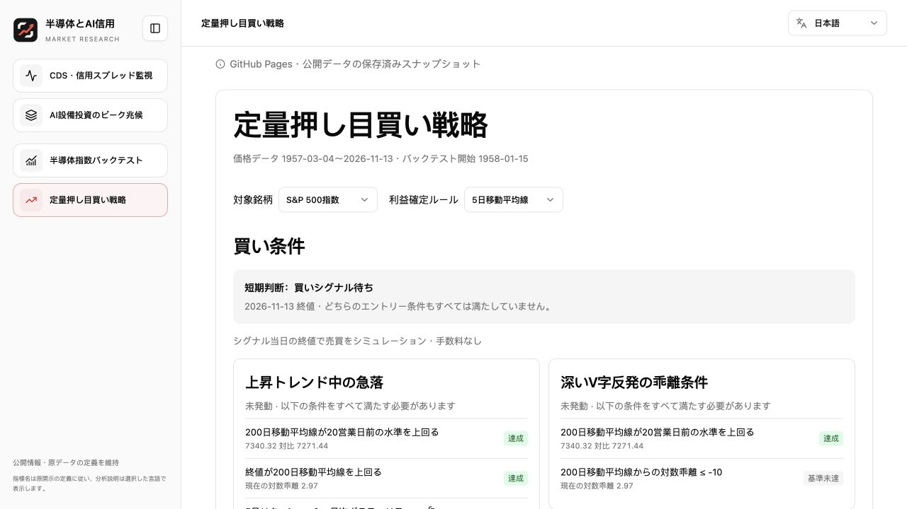

<p align="center">
  <a href="https://ripvanmickey.github.io/ai-credit-monitor/"></a>
</p>

<p align="center">
  <a href="./README.md">English</a> · <a href="./README.zh-CN.md">简体中文</a> · <strong>日本語</strong>
</p>

<p align="center">
  <a href="https://github.com/ripvanmickey/ai-credit-monitor/actions/workflows/pages.yml"></a>
</p>

<p align="center">
  <strong><a href="https://ripvanmickey.github.io/ai-credit-monitor/">ダッシュボードを見る</a></strong> ·
  <a href="https://github.com/ripvanmickey/ai-credit-monitor/actions">公開履歴</a> ·
  <a href="#ローカルでの実行">ローカルでの実行</a>
</p>

AIインフラのサプライチェーンにおける信用リスクと需給の変化を追跡します。フィラデルフィア半導体指数が200日移動平均線を割り込んだ後の回復を振り返り、米国株指数の短期的な押し目買いをシンプルなルールで検証します。

## CDSとAIインフラの投資サイクル

### [CDS・信用スプレッドのモニタリング](https://ripvanmickey.github.io/ai-credit-monitor/)

企業の米ドル建て5年物CDSの水準と変化を比較します。社債利回りと同日の米国5年国債利回りとの差も確認できます。公開日次気配値、DTCC取引の中央値、報道で確認された水準はそれぞれの出所を明示し、共通の観測期間でどの企業のCDSスプレッドが拡大したかを示します。



### [AIインフラ投資のピークを見極める指標](https://ripvanmickey.github.io/ai-credit-monitor/cycle/)

GPUレンタル料金、クラウド事業者の信用リスク、受注残高、半導体メーカーの売上債権回転日数（DSO）を追跡します。受注残高は暦年ベースの四半期をそろえ、各社の開示基準を併記します。



## 半導体指数と定量戦略のバックテスト

### [フィラデルフィア半導体指数のバックテスト](https://ripvanmickey.github.io/ai-credit-monitor/sox/)

SOXが200日移動平均線を下回った過去の局面を振り返ります。初めて移動平均線を回復するまで、5営業日連続で回復を確認するまで、過去の最高値を再び付けるまでの期間を集計します。回復確認後の1、3、6、12か月のリターン分布も確認できます。



### [定量押し目買い戦略](https://ripvanmickey.github.io/ai-credit-monitor/sox/timing.html)

ナスダック総合指数、S&P 500、QQQについて、「上昇トレンド中の急落」と「深いV字反発」の買い条件を項目ごとに確認できます。バックテストでは、売買日、手仕舞いの理由、勝率、平均利益と平均損失の絶対額の比率、取引回数を表示します。



## データの更新

[GitHub Actions](https://github.com/ripvanmickey/ai-credit-monitor/actions) は、米国東部時間の平日18時17分にCDSと株価を確認し、検証できたデータを保存して押し目買いのシグナルを再計算するよう設定されています。通常の公開時には保存済みの市場データを使います。データを更新するには、公開ワークフローを手動で実行し、`refresh_market_data` を有効にしてください。グラフには各系列の観測日を表示します。

## ローカルでの実行

Node.js 24とpnpm 10を使用します。リポジトリにある新しいスクリプトやデータを優先するため、解凍時は既存ファイルを保持します。

```sh
git clone https://github.com/ripvanmickey/ai-credit-monitor.git
cd ai-credit-monitor
unzip -nq research-source.zip
pnpm install --frozen-lockfile
node scripts/close-snapshot.mjs apply
node scripts/build-pages.mjs
pnpm dev
```

ローカルで確認するには [http://localhost:8788](http://localhost:8788) を開いてください。GitHub Pages向けのビルド成果物は `dist/pages/` に出力されます。
