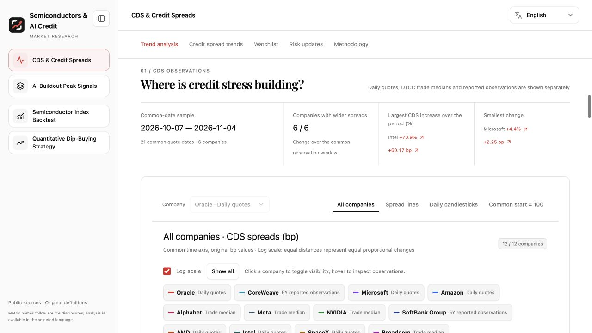
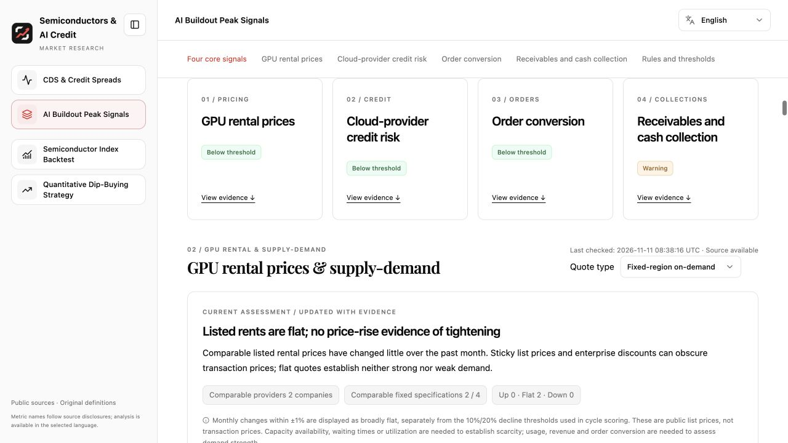
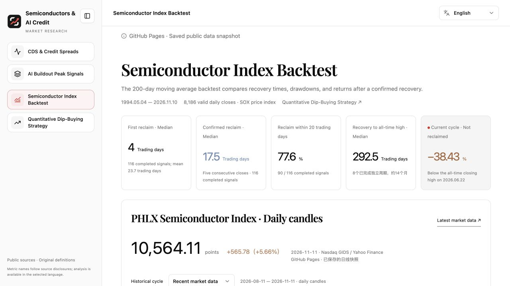
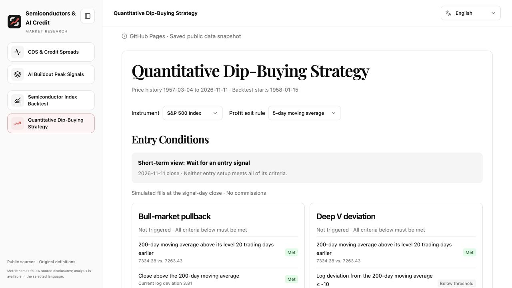

# AI Credit Monitor

**English** · [简体中文](./README.zh-CN.md)

Track credit risk and supply-demand shifts across the AI infrastructure supply chain, study how the Philadelphia Semiconductor Index has recovered after breaks below its 200-day moving average, and backtest simple rules for buying short-term dips in U.S. equity markets.

[Open the dashboard](https://ripvanmickey.github.io/ai-credit-monitor/) · [View deployment history](https://github.com/ripvanmickey/ai-credit-monitor/actions)

## Credit and the AI Infrastructure Cycle

### [CDS and Credit Spread Monitor](https://ripvanmickey.github.io/ai-credit-monitor/)

Compare the levels and changes of corporate 5-year USD credit default swap (CDS) spreads. A separate view shows corporate bond yield spreads over the same-day 5-year U.S. Treasury yield. Public daily quotes, median DTCC trade levels, and media-reported observations are shown separately. A common quote window shows whose CDS spreads widened over the same period.



### [AI Infrastructure Cycle Signals](https://ripvanmickey.github.io/ai-credit-monitor/cycle/)

Track GPU rental rates, cloud-provider credit, contract backlog, and chipmakers’ days sales outstanding (DSO). Backlog figures are aligned by calendar quarter, with each company’s reporting definition shown alongside the data.



## Semiconductor and Quantitative Backtests

### [Philadelphia Semiconductor Index Backtest](https://ripvanmickey.github.io/ai-credit-monitor/sox/)

Review historical episodes when SOX fell below its 200-day moving average. See how long it took to first reclaim the average, stay above it for five consecutive trading sessions, and recover the prior high. The page also shows the distribution of 1-, 3-, 6-, and 12-month returns after the five-session confirmation.



### [Quantitative Dip-Buying Strategy](https://ripvanmickey.github.io/ai-credit-monitor/sox/timing.html)

Check which entry conditions the Nasdaq Composite, S&P 500, and QQQ meet for a sharp selloff in an uptrend or a deep V-shaped rebound. The backtest lists entry and exit dates, exit reasons, win rates, the ratio of average gain to average loss magnitude, and trade counts.



## Data Updates

[GitHub Actions](https://github.com/ripvanmickey/ai-credit-monitor/actions) is scheduled to check CDS and equity prices at 6:17 p.m. Eastern Time on weekdays, save verified observations, and recalculate dip-buying signals. Regular deployments use the saved market snapshot. To request a fresh snapshot, run the publishing workflow manually with `refresh_market_data` enabled. Charts show the observation date for each series.

## Run Locally

Use Node.js 24 and pnpm 10. The extraction command preserves files already in the repository so that newer scripts and data take precedence over copies in the archive.

```sh
git clone https://github.com/ripvanmickey/ai-credit-monitor.git
cd ai-credit-monitor
unzip -nq research-source.zip
pnpm install --frozen-lockfile
node scripts/close-snapshot.mjs apply
node scripts/build-pages.mjs
pnpm dev
```

Open [http://localhost:8788](http://localhost:8788) for the local preview. The GitHub Pages build is written to `dist/pages/`.
