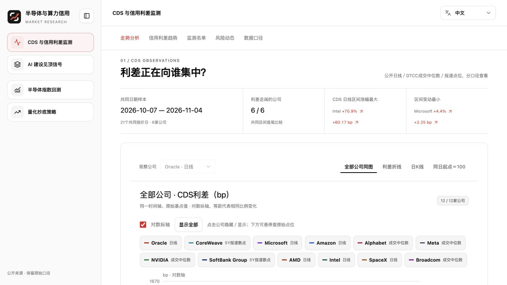
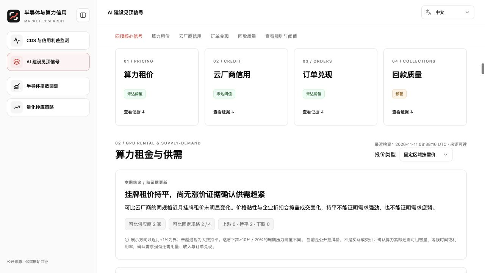
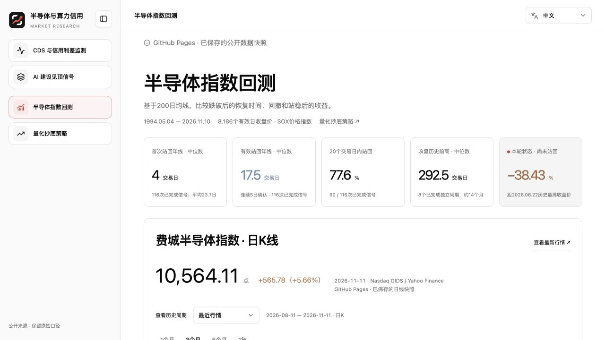
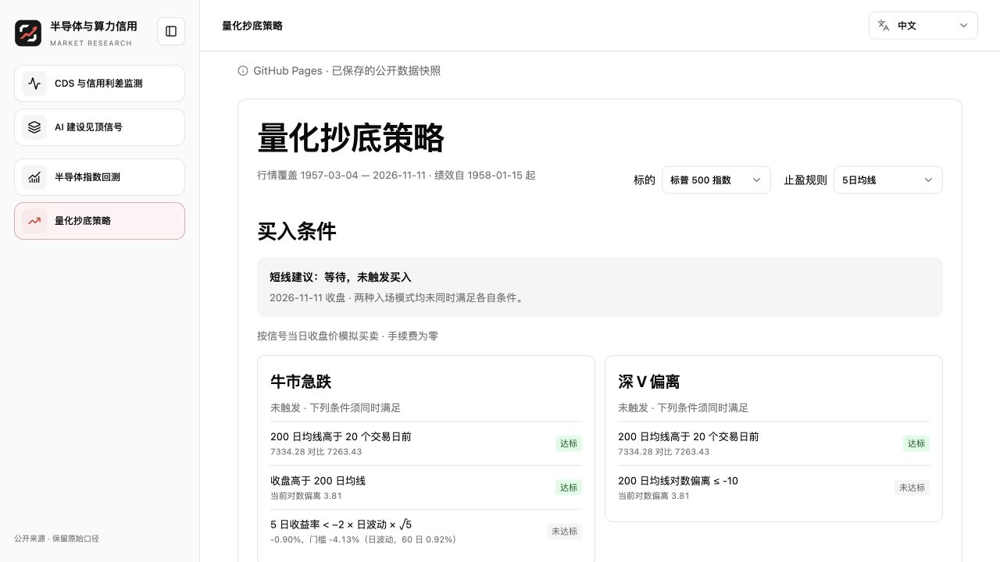

<p align="center">
  <a href="https://ripvanmickey.github.io/ai-credit-monitor/"></a>
</p>

<p align="center">
  <a href="./README.md">English</a> · <strong>简体中文</strong>
</p>

<p align="center">
  <a href="https://github.com/ripvanmickey/ai-credit-monitor/actions/workflows/pages.yml"></a>
</p>

<p align="center">
  <strong><a href="https://ripvanmickey.github.io/ai-credit-monitor/">打开在线面板</a></strong> ·
  <a href="https://github.com/ripvanmickey/ai-credit-monitor/actions">发布记录</a> ·
  <a href="#本地运行">本地运行</a>
</p>

跟踪 AI 算力产业链的信用与供需变化，回看费城半导体指数跌破年线后的恢复路径，并用简单规则检验美股指数的短线抄底信号。

## CDS 与 AI 产业周期

### [CDS 与信用利差监测](https://ripvanmickey.github.io/ai-credit-monitor/)

比较公司 5 年期美元 CDS 的水平与变化，另列公司债相对同日 5 年期美债的收益率利差。公开日线、DTCC 成交中位数和媒体报道分口径展示，便于看清哪些公司在同一报价区间内利差走阔。



### [AI 建设见顶信号](https://ripvanmickey.github.io/ai-credit-monitor/cycle/)

把 GPU 租金、云厂商信用、未履约订单和芯片厂商应收账款周转天数（DSO）放在一起观察。未履约订单按自然季度对齐，并标注各公司的披露口径。



## 半导体与量化回测

### [费城半导体指数回测](https://ripvanmickey.github.io/ai-credit-monitor/sox/)

回看 SOX 跌破 200 日均线后的历史周期，分别统计首次站回、连续 5 个交易日站稳及收复前高所需的时间，并查看站稳后 1、3、6、12 个月的收益分布。



### [量化抄底策略](https://ripvanmickey.github.io/ai-credit-monitor/sox/timing.html)

逐条显示纳斯达克综合指数、标普 500 和 QQQ 是否满足「牛市急跌」与「深 V」的买入条件。历史回测列出买卖日期、退出原因、胜率、平均盈利与平均亏损之比，以及交易次数。



## 数据更新

[GitHub Actions](https://github.com/ripvanmickey/ai-credit-monitor/actions) 定于美东时间周一至周五 18:17 检查 CDS 和股价数据，保存可核验的行情并重新计算抄底指标。常规发版使用仓库已保存的行情快照。需要主动刷新行情时，可手动运行发布工作流并勾选 `refresh_market_data`。图表标注的是各序列自己的观测日期。

## 本地运行

使用 Node.js 24 和 pnpm 10。解压时保留仓库中的同名文件，以便使用独立更新的脚本和数据。

```sh
git clone https://github.com/ripvanmickey/ai-credit-monitor.git
cd ai-credit-monitor
unzip -nq research-source.zip
pnpm install --frozen-lockfile
node scripts/close-snapshot.mjs apply
node scripts/build-pages.mjs
pnpm dev
```

本地预览地址是 [http://localhost:8788](http://localhost:8788)，GitHub Pages 构建产物位于 `dist/pages/`。
